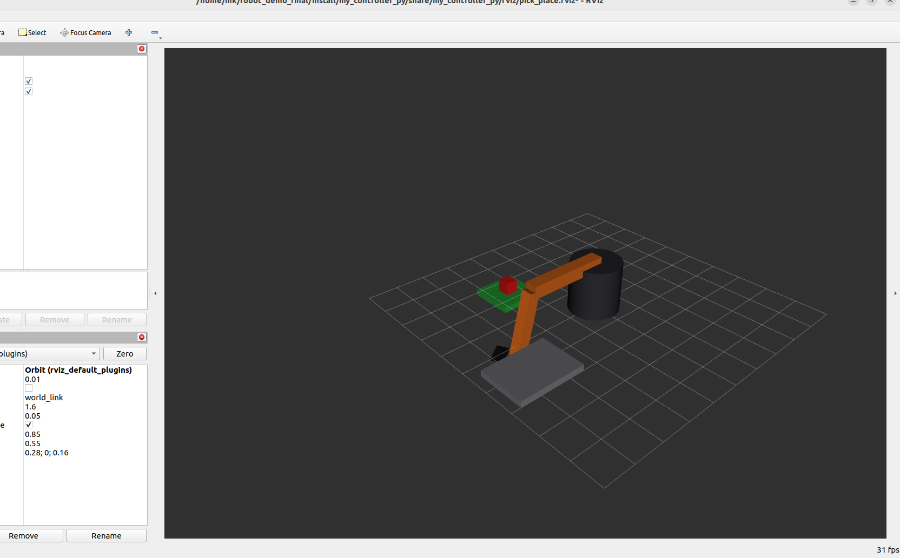

<div align="center">
  
  
  
</div>

# 🤖 Robotic Arm: Pick & Place (ROS2)

Welcome to the **Robotic Arm** project! This ROS2 package contains a lightweight, custom URDF simulation of a robotic arm designed for **pick and place** tasks, visualized dynamically using **RViz2**.



*(Note: Replace `image.png` in the repository with your uploaded image showing the arm picking and placing the block!)*

## ✨ Features

- 🏗️ **Custom URDF Model**: A fully defined robotic arm with revolute joints (`link1`, `link2`, `gripper`).
- 🎯 **Smooth Trajectories**: A Python-based joint state publisher orchestrates the arm's movement using trigonometric interpolation for seamless sweeps.
- 👁️ **RViz2 Integration**: Beautiful, real-time visualization of the arm, the workspace, and the target object directly in RViz.
- 🚀 **Plug & Play Launch**: Single-command bringup for the entire simulation stack.

## 📁 Project Structure

* `my_robot_description`: Contains the custom URDF model (`arm.urdf`) defining the robot's physical structure, visual properties, and kinematics.
* `my_controller_py`: Contains the `demo.py` node that publishes joint commands to `/joint_states`, bringing the arm to life. Also houses the master `rviz.launch.py`.

## 🛠️ Quick Start

### 1. Build the Workspace

Navigate to your workspace and build the packages:

```bash
cd ~/robot_final
colcon build
```

### 2. Source the Setup File

```bash
source install/setup.bash
```

### 3. Launch the Simulation!

Start the `robot_state_publisher`, the joint controller, and RViz2 all at once:

```bash
ros2 launch my_controller_py rviz.launch.py
```

Watch as the arm springs to life in RViz, simulating its pick and place sequence!

## 🔧 Troubleshooting

If the arm appears to "teleport" or behave erratically in RViz, ensure that:
- Your `robot_state_publisher` is running properly (check terminal for URDF parsing errors).
- All revolute joints in your URDF have appropriate `<limit>` tags. 
- You are not running conflicting joint state publishers.

## 🤝 Contributing

Feel free to fork this project and add your own inverse kinematics, MoveIt2 integration, or custom end-effectors!

---
*Built with ❤️ using ROS2.*
